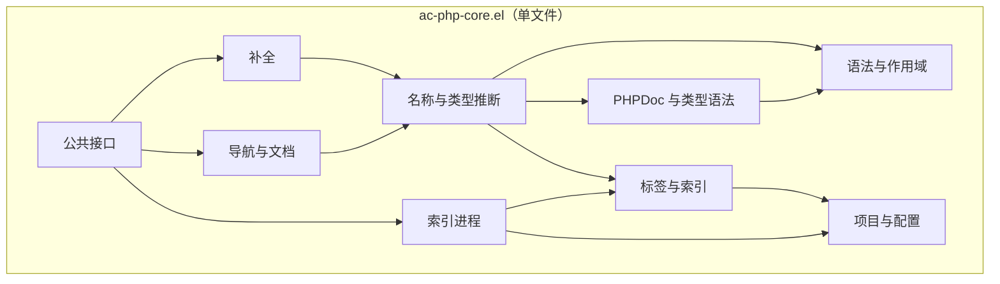

# ac-php-core 审查与重构方案

审查日期：2026-11-04。审查基线：`dff1c73`，当时 `ac-php-core.el` 共 5,086 行。下列问题表中的行号指审查基线，修复进展见第 9 节，职责归组与历史 API 清理见第 10 节。

本文记录问题审查、单文件内的职责设计与分阶段整合计划，以及后续修复进展。已完成 Emacs 31.1 的开发环境和第 9 节列出的首批修复；其余目标设计按阶段推进。

实施约束：MELPA recipe 只指定了 `ac-php-core.el`，因此核心保持单文件，不拆出需要额外打包或加载的 `.el` 实现文件。下文的职责分区均位于原文件内。PHP 标签生成器源码位于 `~/phpctags`（本机 `/Users/jim/phpctags`），本仓库 `phpctags_src` 链接指向该目录。

## 1. 审查结论

主要问题是多套解析逻辑并存，以及状态和缓存没有统一的归属。重构在 `ac-php-core.el` 内统一这些实现，并明确函数、数据和状态的职责边界。

现有的标签文件签名缓存、按标签代次建立的类成员索引、继承图去重和结构化链式表达式解析值得保留。重构应在这些实现上建立统一的作用域、调用解析和补全上下文，并补齐索引进程的生命周期管理。

审查时确认了 9 项行为问题和 4 项性能问题。当时已有 185 个 ERT 测试均通过，这些场景未被原有用例覆盖；修复后测试已扩展至 204 项。

## 2. 审查基线中已复现的行为问题

优先级：P1 表示可能卡住编辑器或混用项目数据；P2 表示特定场景下结果错误、更新失效或状态异常。

| 编号 | 优先级 | 位置 | 触发条件与实际结果 | 修复方向 |
| --- | --- | --- | --- | --- |
| B1 | P1 | `ac-php-core.el:3920`，`ac-php--variable-assignment` | 赋值右侧字符串或嵌套块内有分号时，扫描可反复停在同一分号，补全无法结束 | 查询语法状态时保护 point，并保证每轮向前推进；跳过整个字符串、注释或嵌套表达式 |
| B2 | P1 | `ac-php-core.el:2057`，`ac-php--get-tags-save-dir` | 默认缓存目录把路径分隔符替换为 `-`，`a-b/c/` 与 `a/b-c/` 得到相同目录 | 使用规范化项目路径的摘要作为唯一键；为旧缓存目录提供迁移策略 |
| B3 | P2 | `ac-php-core.el:4259`，`ac-php--assignment-return-type` | `$x = outer(inner());` 推断为 `inner` 的返回类型，数组键补全得到 `inner_key` 而非 `outer_key` | 解析赋值右侧的结果表达式，以最外层返回值为准；保留源码位置映射 |
| B4 | P2 | `ac-php-core.el:4083`、`:4182` | 同一文件 A、B 两个类均有 `configure` 方法；调用 `$a->configure(...)` 时，局部 PHPDoc 查找可取到 B 的参数类型 | 以 namespace、所属类、方法名和声明位置标识 callable，不能只按方法短名寻找最近声明 |
| B5 | P2 | `ac-php-core.el:990`、`:688` | `use Vendor\{Foo, Bar};` 下，普通 `Foo` 类型解析返回 nil、成员链返回 `"null"`；PHPStan 导入解析却能得到 `\Vendor\Foo` | 统一 use 解析及命名空间规则，区分类、函数、常量导入和 trait use |
| B6 | P2 | `ac-php-core.el:1964` | 设置全局重建标志后，后端配置或启动准备抛错，没有恢复标志；纠正配置后的下一次重建被跳过 | 同步失败路径必须释放占位状态；成功启动后由进程终结路径清理 |
| B7 | P2 | `ac-php-core.el:1919`、`:5006` | sentinel 在另一个当前 buffer 中运行时，原 buffer 的 `ac-php-mode` 仍为 t，但全局重建标志已经清除 | 状态归属项目与 process；记录相关 buffer，显式更新存活 buffer，不依赖回调时的当前 buffer |
| B8 | P2 | `ac-php-core.el:1944` | 进程分块输出 `"7"`、`"5%..."` 时进度变成 5；`"PHPPar"`、`"ser:..."` 分块时错误被漏掉 | 每个进程保存未完成行；只解析完整行，结束时处理剩余片段 |
| B9 | P2 | `ac-php-core.el:3214`，`ac-php--phpstan-source-aliases` | 常规字节编译时 `php-mode-hook` 未声明为动态变量，其 nil 绑定被当作未使用的词法变量；加载编译后的核心进行一次外部 alias 补全，用户 PHP mode hook 实际运行 1 次 | 正确声明/延迟运行 mode hooks，在临时源码分析时抑制用户初始化副作用；分别测试源码与字节编译加载 |

### B1：补全卡住的最小输入

```php
<?php
function run() {
    $x = load('a;b');
    $x['']; // 在引号中触发数组键补全
}
```

`search-forward` 找到分号后，`syntax-ppss` 把 point 移回该分号；这个分号不是赋值结束位置，于是下一轮又找到相同字符。审查时给扫描增加了循环次数保护，得到起点序列 `(28 36 36 36 36 36 36 36 36)`，避免实际挂住测试进程。

回归测试应验证有限的扫描次数与正确的赋值范围，不能仅依靠超时测试；字符串分号、注释分号和闭包体分号均需覆盖。

### B3/B4：统一调用解析的必要性

```php
/** @return array{outer_key: int} */
function outer($value) {}
/** @return array{inner_key: int} */
function inner() {}
function run() {
    $x = outer(inner());
    $x['']; // 当前得到 inner_key，应得到 outer_key
}
```

B4 的复现中，A 的 `configure` 参数为 `array{wrong_key: int}`，B 的同名参数为 `array{right_key: int}`，对 A 实例调用却补出了 `right_key`。两个类型标签只是复现中的字段名，不能把输出名字看成正确性判断。方法归属而非源码距离应决定结果。

另一个关联风险是赋值文本经过 trim、注释替换后，不能直接把字符串偏移加到原始源码起点；B3 的修复必须同时解决位置映射。

B9 说明不能把所有编译警告当成纯样式问题：`Unused lexical variable php-mode-hook` 对应实际的行为差异。外部源码读取还会重复发生，因而用户 hook 中的服务启动、buffer 设置等操作也可能被重复触发。需要统一临时源码的分析入口，而不是只消除警告文本。

### 索引状态的收敛目标

```text
idle -> starting -> running -> succeeded
                  |        -> failed
                  |        -> cancelled
       |-> failed
```

每个终态都必须释放该项目的活动进程、刷新相关 buffer 的显示状态，并保留可诊断的结果。启动失败不能留下锁；一个项目失败不能阻止其他项目索引。调试开关不能绕过并发保护创建互相覆盖的进程。

## 3. 已验证的性能开销

这些数据用于定位算法和重复操作，不是实际大型 PHP 项目的延迟承诺。

| 编号 | 位置 | 审查证据 | 优化目标 |
| --- | --- | --- | --- |
| P1 | `ac-php-candidate-other`，`:1623` | 构造 100,000 个标签，在 `namespace App` 下补全一个零匹配前缀，仍调用 `s-prefix-p` 200,015 次 | 标签代次内建立可按 namespace 和前缀定位的索引，查找目标为 `O(log N + K)`，不每次遍历整个 hash table |
| P2 | `ac-php--phpstan-source-aliases`，`:3187` | 同一 buffer、同一位置连续做 5 次导入数组类型补全，外部类型源文件读取 5 次 | 缓存源码语义摘要与 alias 依赖；未变化时不重复读文件或启动 php-mode |
| P3 | `ac-php-get-tags-file` / `ac-php--get-config`，`:2068`、`:2114` | 连续查询 5 次标签文件位置，JSON 配置重新读取 5 次；已有标签缓存不覆盖这一开销 | 配置按文件签名缓存；先保留廉价的有效性检查，再单独优化项目根发现 |
| P4 | `ac-php--array-shapes-fields`，`:3643` | 合并每个字段均执行 alist 查找，新字段又 append 到尾部，形成二次复杂度；250/500/1000/2000 字段的三次合并总时间约 0.014/0.018/0.065/0.168 秒 | 用 hash table 查询已见字段，用 push/nreverse 保留声明顺序，并去重联合类型 |

上述 shape 微基准显式加载当前 `.el`，核心函数以解释方式执行；数字仅用于辅助确认增长趋势。补充观察：`ac-php--phpstan-qualify-type` 反复创建剩余字符串，长类型表达式可能产生大量分配；签名解析创建临时 buffer；prefix 与 candidate 阶段重复计算 array/literal context。这些应在文件内整合时增加计数后确认收益，不能只凭函数长度决定重写。

### 缓存键与失效规则

| 缓存 | 键 / 归属 | 必须失效的条件 | 约束 |
| --- | --- | --- | --- |
| 项目配置 | 项目身份 + 配置文件路径与签名 | 配置内容变化、删除、项目切换、realpath 策略变化 | 不修改调用者的 `default-directory`；缓存完整解析结果 |
| buffer 语义摘要 | buffer 身份 + `buffer-chars-modified-tick` + major-mode | 编辑、切换模式、buffer 关闭 | 记录 namespace/use/声明/作用域；不长期保留完整 buffer 文本 |
| 标签代次 | 项目身份 + 项目/vendor 标签签名 | 任意一侧标签变化或消失 | 保留完整时间、文件身份、大小的签名方案；项目与 vendor 一致发布 |
| 类成员索引 | 标签代次 + 类名及所需 namespace | 标签代次替换 | 保留现有弱引用与继承图访问去重；不回退到每次展开完整继承树 |
| 源码 PHPDoc / alias | 文件身份与签名，或已打开 buffer 的修改 tick | 源文件/未保存 buffer 变化、传递导入依赖变化 | 未保存 buffer 优先；A 导入 B、B 导入 C 时 C 的变化也要传播 |
| 请求上下文 | buffer、point、修改 tick、标签代次 | 上述任意项变化 | prefix/candidates 可复用同一快照；不能把不同光标位置的上下文混用 |

第一轮优先做配置缓存、源码摘要缓存和代次内符号索引。项目根发现的缓存涉及新建/移动配置文件，待刷新机制和测试齐备后再做，避免永久绑定旧根目录。

## 4. 单文件内的职责分区与调用方向

`ac-php-core.el` 继续包含全部核心实现，并提供现有的 `ac-php-core` feature。除第 10 节明确移除的历史 API 外，已有对外函数名、变量和候选项 text properties 保持可用。通过文件内章节、共享辅助函数和内部数据契约组织以下职责；分区名称不对应新增文件，也不新增分区间的 `require` / `load` / `provide`。

| 文件内分区 | 职责 | 现有实现 |
| --- | --- | --- |
| 公共接口与定制 | 对外 API、customize group、兼容适配和初始化 | 现有核心的公共接口与变量 |
| 项目与配置 | 项目身份、根目录、配置、缓存目录和配置失效 | `--get-project-root-dir`、`--get-config`、`--get-tags-save-dir` |
| 索引进程 | 后端命令、每项目进程状态、输出分块、重建/取消、进度通知 | `--remake-tags*`、`--rebuild-file-list`、filter/sentinel |
| 标签与索引 | 标签协议适配、代次缓存、类/函数/继承访问、成员与前缀索引 | `load-data`、`g--*`、`--class-lookup-*`、成员查询 |
| 语法与作用域 | buffer 中表达式范围、链、参数范围、作用域、namespace/use 的语法事实 | `--chain-*`、`--expression-*`、syntax/scope helpers |
| PHPDoc 与类型语法 | PHPDoc 规范化、tag 提取、类型表达式和签名语法；返回结构化事实 | `--phpdoc-*`、类型字符串扫描、shape 字段解析 |
| 名称与类型推断 | 名称/调用/变量/返回类型解析、PHPStan alias 导入与依赖、统一符号结果 | 类名解析、assignment/foreach 推断、`--callable-tag`、alias 解析 |
| 补全 | 请求上下文、候选项生产、过滤、元数据和共享插入动作 | `candidate*`、`--array-key-post-completion` |
| 导航与文档 | 符号跳转、参数/alias 定义位置、位置栈、共用文档输出与 ElDoc 入口 | `find-symbol*`、`goto-*`、tip/eldoc/位置栈 |

文件内的调用方向：



约束：共享 helper 按语法、数据与状态的归属组织，避免各条补全路径重复扫描和解析；PHPDoc 语法层不反向触发标签加载或补全；process filter 不调用语义解析。可定制变量与相关实现在文件内归组，保持现有变量名和 customize group。核心实现始终由 MELPA 已收录的单文件完整提供。

### 统一的内部数据契约

- **Project**：规范化身份、根路径、配置快照、标签目录、活动任务和当前标签代次。项目身份遵守 `ac-php-project-root-dir-use-truename`，路径中的 `-` 不再参与歧义编码。
- **Tags generation**：加载完成后视为只读，包含现有索引、签名和派生索引；新代次完整建好后再替换。文件名/成员向量的旧协议由适配层处理，不在本轮重定义 Rust 输出。
- **Scope / Callable**：声明位置、namespace、所属类、成员种类、全名、参数和返回类型。局部方法、跨文件方法、全局函数和构造函数共享同一解析结果。
- **Resolved symbol**：种类、真实定义位置、所属声明、原始/已解析类型、来源标签。内部位置采用文件 + 行/列或 buffer + marker，字符串格式只在旧 API 边界转换。
- **Completion request**：buffer、point、修改 tick、project、tags generation、语法和类型上下文；一次构造，多种候选生产器读取。
- **Candidate**：插入文本、显示文本、kind、类型、帮助、定义位置、插入动作；对现有前端转换回带现有 text properties 的字符串。

实现可使用 `cl-defstruct` 或明确的 plist，不引入新的运行时包或要求 tree-sitter。对外仍保留当前字符串候选和 legacy tags vectors。

## 5. 需要整合的重复实现

1. **导入与命名空间**：`get-use-as-name`、`--get-all-use-as-name-in-cur-buffer`、`--phpstan-use-name` 合并为同一份作用域导入表；分别处理 class/function/const，保留 grouped use、逗号多项导入和大小写规则。
2. **调用解析**：局部声明、tagged callable、`@method` 和赋值返回类型都读取同一个 callable；数组键、字符串字面量和命名参数不再自行猜测接收者或参数索引。
3. **变量类型**：对象成员链与 array-shape 共用按作用域和源码位置限定的变量来源；不能只用变量名防环，否则合法的变量重新赋值也可能被误判成循环。
4. **分隔与扫描**：`--split-top-level-type`、`--top-level-colon`、括号/尖括号匹配共享对引号、转义和嵌套层次的处理。buffer 扫描与字符串扫描保留各自适配层，不用同一个粗糙正则覆盖两者。
5. **候选构造**：`candidate-other` 多处分支重复设置相同 text properties；用一个候选转换函数并分别表达来源与过滤规则，避免前端靠字符串内容猜测类型。
6. **请求上下文**：统一 prefix 与 candidate 阶段的 array/literal/named-argument 判断。保留 provider 在无 tags-data 时查询 prefix 的扩展契约，并保持当前优先级。
7. **文档展示**：`show-tip` 与 ElDoc 共用 resolved symbol 和文档格式化，展示层只决定交互方式。
8. **遗留功能**：已核对调用清单，并按用户要求移除第 10 节所列的历史函数；`--clean-return-type`、`gen-el-func` 等未列入本次删除范围的函数归回对应类型和签名处理分区。

## 6. 分阶段整合与验收

每阶段应是可独立检查和回退的改动。行为修复与纯移动代码分开，避免把回归归因于两种变化。

| 阶段 | 内容 | 验收条件 |
| --- | --- | --- |
| 0：开发基线 | Emacs 31.1/Cask 初始化、测试/编译、无 Cask CLI 的本地依赖加载；记录兼容性与性能基线 | 本轮已完成；31.1 上完整 ERT 与字节编译通过，30.2 的目录不被冒充成 31.1 |
| 1：补齐严重回归 | 先为 B1/B2 写有明确断言的回归，再修复扫描推进和缓存目录冲突 | B1 所有嵌套/引号场景终止；不同根目录输出分离；旧标签重新生成/迁移行为明确；所有既有测试通过 |
| 2：项目与索引 | 在原文件内整合项目配置和索引流程；修复 B6/B7/B8；按项目管理任务与状态，缓存 JSON 配置 | 启动失败/退出/取消/源 buffer 被关闭均释放状态；两个项目互不阻塞；任意分块输出与完整输出结果一致 |
| 3：统一语法事实 | 在原文件内合并语法和 PHPDoc 的重复 helper；统一 namespace/use/scope 和顶层分隔器，修复 B5 | grouped/多项/use function/use const、trait use、匿名函数、注释/字符串和未闭合编辑状态均有测试；point/match-data 保持 |
| 4：统一类型与调用 | 在原文件内统一名称、调用和类型推断；修复 B3/B4/B9；对象、数组和各种参数补全共享调用与变量来源 | 同名不同类/namespace不串用；嵌套调用取外层返回值；跨文件 alias、继承和未保存 buffer 的行为保持；临时分析源码在两种加载方式下均不执行用户 mode hooks |
| 5：索引与缓存优化 | 在现有标签逻辑上增加前缀索引、PHPDoc/alias 依赖缓存、签名缓存；修复 shape 合并二次复杂度 | 零匹配前缀不遍历全部标签；连续请求不重复读取同一未变源码；修改传递依赖会失效；继承访问次数继续按唯一节点增长 |
| 6：统一补全与导航 | 在原文件内整合候选构造、插入、符号解析和文档输出，完成职责归组并更新文档 | 两个前端的候选、过滤、插入和跳转集成测试通过；公共 API 可用；MELPA 仅收录现有核心单文件时仍能完整加载和运行 |

不为行数设硬阈值：`ac-php-core.el` 继续承担全部核心职责，通过统一 helper、数据契约、缓存和章节组织减少重复与耦合。

### 各阶段必守边界

- 保留 `auto` / `mago` / `phpctags` 后端与 CLI 参数契约。
- 保留 `tags.el` / `tags-vendor.el` 与 `g-ac-php-tmp-tags`，vendor 文件索引仍先于项目索引；成员向量第九字段保持带类型参数语义。
- 保留用户 provider、candidate text properties、两个前端的插入行为和已支持的 PHPStan alias/shape 功能。
- Emacs 31.1 是本轮已验证的开发环境；原有 24.4/25.1 声明存在不一致，最低支持版本需单独决策，不能借重构直接提高到 31.1。
- 核心始终保持 `ac-php-core.el` 单文件，遵守 MELPA recipe 的现有收录范围；不以修改 `Cask`、`Makefile` 或 `cp2elpa.sh` 作为增加核心运行时文件的替代方案。
- 不把整个项目 AST 或所有源码永久保存在全局表中；缓存有明确归属，buffer 关闭和代次替换后能释放。

## 7. 验证矩阵

| 领域 | 必测场景 |
| --- | --- |
| 扫描与作用域 | point-min、narrowing、多行、注释/字符串分隔符、不完整 PHP、嵌套匿名函数、同名不同声明 |
| 类型推断 | 注解/参数/赋值/foreach、外层与内层调用、继承、late-bound 返回类型、循环/传递 alias |
| 三类参数补全 | 数组 shape、字符串字面量、命名参数；普通函数/实例方法/静态方法/构造函数 |
| 前端 | core、company、auto-complete；prefix、候选顺序和属性、插入文本、光标位置、point 不变 |
| 标签与缓存 | 首次加载、只改 vendor、项目标签消失/原子替换、配置变化、打开且未保存的源文件、跨项目隔离 |
| 进程 | 启动失败、异常退出、取消、任意切块、多个项目、buffer 被关闭、旧任务回调晚到 |
| 兼容与交付 | 31.1 全量 ERT、选定旧版本、按现有 MELPA 收录范围构建安装包后的 `require` 烟测；核心单文件源代码/字节编译两种加载 |

性能验收先使用可稳定断言的操作次数：文件读取次数、全表遍历次数、继承节点访问次数、扫描推进次数。另维护 1k/10k/100k 标签与长 PHPDoc 的 benchmark；基于相同工具链、编译状态、GC 设置和样本多次比较中位数，再决定延迟门槛。

## 8. 本轮开发环境改动与验证记录

- 已安装 Cask 到本机 `~/.cask`，为实际 Emacs 31.1 安装独立的 `.cask/31.1/elpa` 依赖，并保留原 `.cask/30.2`。
- Makefile 的无 Cask 路径改为检查当前 Emacs 主次版本的 elpa 目录；`make init` 每次显式运行依赖安装，安装失败不把目录标记为成功。
- `test/dev-env.el` 为直接 batch 编译和测试共用依赖加载逻辑；不在 31.1 中自动降级使用 30.2 的包目录。
- 旧 `ert-runner` 的 generated autoload 会调用 `defmacro*` 并覆盖内置 ERT，31.1 环境实际出现加载错误。移除该开发依赖，统一使用内置 ERT，并在本地 package 初始化时排除旧目录残留的 runner。`TESTFLAGS` 随之改为 Emacs batch 参数。
- README 记录版本升级后的初始化方式。`Cask` 原有最低版本约束已经允许 31.1，无需把包的最低支持版本改成 31.1。
- 实际执行结果：31.1/Cask 的 `make init`、`make test`（185/185）和 `make build` 成功；显式设置 `CASK=/nonexistent` 的测试（185/185）与强制重新编译四个模块也成功，两种路径均无旧 runner 的 autoload 加载错误。无 Cask 时执行 `make init` 会明确失败，提示安装依赖所需工具。
- 编译仍有原有的 lexical-binding、未知函数和未使用参数等警告，未将其伪报为零警告；其中 `php-mode-hook` 警告对应 B9 的真实问题，已列入修复阶段。
- 审查探针独立于默认测试执行，确认了本文列出的 9 项行为问题及性能计数；后续修复与回归验证见第 9 节。

## 9. 首批修复与验证（2026-11-04）

全部核心改动保留在 `ac-php-core.el` 内，没有增加核心运行时文件。

| 问题 | 已实施的修复 | 回归验证 |
| --- | --- | --- |
| B1 | 查询分号语法状态时保护 point，扫描持续推进 | 字符串、注释和闭包体内含分号；对扫描次数设上限，防止用例挂住 |
| B2 | 默认目录使用规范化项目路径的 SHA-256；旧目录不复用，按需重建；显式 `tag-dir` 保持有效 | 两种冲突路径生成不同目录；路径末尾斜杠保持一致；错误时不改变 `default-directory` |
| B3 | 在原 buffer 中定位最终调用及其匹配括号，避免使用清理文本后的偏移 | 外层/内层调用、注释、分组括号，在 core/company/auto-complete 三个入口均取外层类型 |
| B4 | 局部声明匹配所属类和 namespace；可用标签时采用实际声明类 | 同一文件两类同名方法，在三个补全入口均使用接收者的参数类型 |
| B5 | 普通补全与 PHPStan 复用按 buffer 修改版本和 namespace 范围缓存的导入表 | grouped use、别名、多个 namespace；function/const 导入不误作类导入；保留原导入去重用例 |
| B6 | 活动任务按项目记录，进程成功启动前不获取全局锁 | 无效后端失败后可重试；同项目去重、不同项目并行；调试模式仍遵守去重 |
| B7 | 进程记录关联 buffer，终结回调只清理仍绑定到该进程的指示状态 | 在其他当前 buffer 中终结任务，正确清理原 buffer，并保留另一项目的状态 |
| B8 | 每个进程保留不完整输出行，结束时处理剩余文本 | 逐字符传入 CRLF、百分比和 PHPParser 错误，结果与整行一致 |
| B9 | 外部源码统一进入有界私有 buffer 缓存，初始化 PHP mode 时延迟用户 hooks | 源码与字节编译两种加载均验证 hooks 不执行，用户未保存 buffer 优先 |

PHP 标签生成器的配套修改位于 `/Users/jim/phpctags/bootstrap.php` 和 `deal_config.php`：新增可选 `--output-dir`，直接使用 Emacs 解析出的完整目录。未传入该参数时保持旧 CLI 行为。已按该仓库的 `buildPHAR.php` 流程重建，并更新本仓库 `phpctags` 打包文件。

| 热路径 | 修复后的行为与测量 |
| --- | --- |
| P1：全局候选扫描 | 每个标签代次惰性建立排序索引，前缀二分查找，按原标签顺序返回结果。10 万标签、预热后的 10 次零匹配补全全表扫描次数为 0；合计约 0.000425 秒。首次构建成本为 `O(N log N)`；匹配后保留原顺序需要 `O(K log K)`，热查询总成本为 `O(log N + K log K)` |
| P2：外部源码读取 | 同一未变化文件连续 5 次查询只读 1 次；修改文件即刷新，未保存用户 buffer 优先；传递导入的叶子文件变化也会被发现。私有分析 buffer 数量限制为 32，嵌套查询期间保护正在使用的 buffer |
| P3：配置读取 | 按完整文件签名缓存解析结果；连续 5 次查询只解析 1 次，内容变化或删除后重新读取/生成配置 |
| P4：shape 合并 | 使用 hash table 查询已见字段，push/nreverse 保持顺序，并去重重复联合类型。解释执行下 250/500/1000/2000 字段三次合并总时间约 0.007/0.014/0.029/0.059 秒 |

以上计时仍是合成微基准，主要验收依据为正确性、失效行为和操作次数。

已完成验证：

- Emacs 31.1 上，字节编译形式与显式加载源码形式分别通过 204/204 ERT；新增 19 项回归位于 `test/ac-php-core-regression-test.el`。
- `make build` 成功；核心中的 `php-mode-hook` 编译警告已消除。
- PHP 修改通过语法检查；重建后的打包文件验证了带空格输出目录和两个项目输出隔离。
- 真实 PHP 后端异步索引、sentinel 清理和 Emacs 标签加载连通验证通过。
- 首次索引尚未结束时，标签读取返回 nil，补全等待实际标签数据就绪，避免把运行中的 process 当作标签结构。
- 将核心单文件复制到独立临时安装目录后，`require 'ac-php-core` 成功，确认没有依赖本仓库中新拆出的核心实现文件。
- 两个仓库的 `git diff --check` 通过。

文件内职责归组见第 10 节；签名与请求上下文复用、文档展示去重等仍待后续整合。

## 10. 职责归组与历史 API 清理（2026-11-04）

本次以代码组织和功能内聚为范围，保留单个核心实现文件，将实现归入以下连续分区：

| 分区 | 归组内容 |
| --- | --- |
| 共享工具 | 调试、前端共用 helper、case-fold hash test、文件签名 |
| Buffer 语法与作用域 | 语言词表、声明正则、函数边界、当前符号、注释处理和参数范围 |
| 项目与标签 | 项目发现与配置、后端与索引进程生命周期、标签加载与数据访问 |
| 名称、表达式与类成员 | namespace/imports、继承与成员索引、token/chain 解析和接收者类型推断 |
| PHPDoc 与类型推断 | PHPDoc 文本、源码 buffer、PHPStan aliases、类型表达式和共享 callable 查询 |
| 补全 | 数组、字符串、具名参数各自的上下文与候选生成，以及通用补全调度 |
| 导航与文档 | 位置栈、定义跳转、Cscope 查询、popup/ElDoc 和项目信息 |
| 初始化 | minor mode 与 ElDoc setup |

配置、索引进程、标签代次、源码 buffer、imports、成员与函数前缀索引的状态变量分别放回所属分区。共享 callable 定位与签名解析从具体补全功能中集中出来；数组键插入 helper 与数组候选生成相邻。

圆括号和尖括号匹配复用 `ac-php--matching-delimiter-in-string`，保留原有两个 wrapper。宏、内联 helper 和共享词表保持在使用者之前，避免重排引入编译时的声明差异。

按用户要求删除仓库内无活动调用的六个历史函数：`ac-php-find-php-files`、`ac-php--cache-files-save`、`ac-php--remake-cscope`、`ac-php--get-obj-tags-dir`、`ac-php--get-obj-tags-file-list`、`ac-php-save-data`；同时删除无调用的旧配置提示 helper `ac-php--get-config-path-noti-str`。当前 Cscope 查询命令仍归在导航分区。
